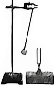
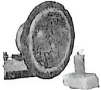

23. 如图14所示，小实同学完成以下四个实验，请回答相关问题。

甲

乙

丙

丁

（1）如图甲所示，该装置中乒乓球被弹开，说明了发声的音叉在 ___ 。

（2）如图乙所示，通过用相同大小的力拨动伸出长度不同的钢尺，发现钢尺振动的快慢不同，该实验可以探究音调的高低与钢尺振动的 ___ 的关系；

（3）如图丙所示，在无风的情况下，发现正在发声的扬声器旁边的烛焰不断晃动，说明声波能传递 ___ 。

（4）如图丁所示，自制温度计的玻璃管越细，外界温度变化时，管中液柱高度的变化越 ___ （选填“明显”或“不明显”）

> [!question]- 点击查看答案与解析
> 【答案】（1）振动；（2）频率（快慢）；（3）能量；（4）明显
> 
> 【考点】声音的产生、音调与频率、声波传递能量、温度计的原理 → [[【初中物理知识点体系-北师大版】#3-1 声音的产生与传播]]、[[【初中物理知识点体系-北师大版】#3-2 声音的特性]]、[[【初中物理知识点体系-北师大版】#1-1 温度及其测量]]
> 
> 【解析】
> （1）音叉发声时振动，把靠近的乒乓球弹开，乒乓球将音叉的微小振动放大，说明发声的音叉正在振动，声音是由物体振动产生的。
> （2）钢尺伸出长度不同时，振动部分的长度不同，振动快慢（频率）不同，发出声音的音调不同，故探究音调与频率的关系。
> （3）扬声器发声时，声波使烛焰晃动，说明声波能传递能量。
> （4）玻璃管越细，管内液体体积变化相同时，液柱高度变化越大，因此外界温度变化时液柱高度变化越明显（灵敏度越高）。
> 
> 【易错点】第（1）问只答“发声”，漏掉“振动”；第（2）问把“频率”写成“振幅”；第（3）问混淆“传递信息”与“传递能量”。
