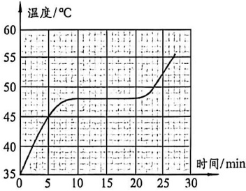

24. 小实同学在探究某物质熔化过程中温度随加热时间变化的特点时，持续加热该物质，记录、描绘出了该物质温度随时间变化的图线，如图15所示。

图15

（1）从图像可知该物质是 ___ （选填：“晶体”或“非晶体”），依据是 ___ 。

（2）该实验中，小实同学看到 ___ （选填：“烧杯中有液体出现”或“温度计示数不变”）现象，说明该物质开始熔化。

（3）该物质的熔点是 ___ ℃。温度为 $52^{\circ}\text{C}$ 时，该物质处于 ___ 态。（选填“固”或“液”）

> [!question]- 点击查看答案与解析
> 【答案】（1）晶体；熔化过程中温度保持在 $48^{\circ}\text{C}$ 不变（有固定的熔点）；（2）烧杯中有液体出现；（3）$48$；液
> 
> 【考点】晶体与非晶体的区别、熔点和熔化特点 → [[【初中物理知识点体系-北师大版】#1-2 熔化和凝固]]
> 
> 【解析】
> （1）图像中 $48^{\circ}\text{C}$ 处有一段温度不变的水平线段，说明该物质有固定的熔化温度，是晶体。
> （2）物质开始熔化时会由固态变为液态，可观察到烧杯中出现液体；而“温度计示数不变”是晶体熔化过程中的特点，不能作为“开始熔化”的标志。
> （3）水平段对应的温度为熔点，即 $48^{\circ}\text{C}$。$52^{\circ}\text{C}$ 高于熔点，此时熔化已完成，物质处于液态。
> 
> 【易错点】把“温度计示数不变”当作开始熔化的现象；忽略 $52^{\circ}\text{C}$ 高于熔点而误答“固”。
