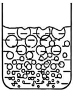
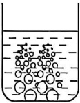

25. 小实同学做“探究水在沸腾前后温度变化的特点”实验中，观察水内部的现象并从水温达到 $90^{\circ}\text{C}$ 时开始计时，每隔 $1\text{min}$ 记录一次温度，其数据如下表所示。

甲

乙

图16

（1）图16中，图 ___ （选填“甲”或“乙”）反映了水沸腾后的现象；

| 时间/min | 0 | 1 | 2 | 3 | 4 | 5 | 6 | 7 | 8 | 9 | 10 |
| --- | --- | --- | --- | --- | --- | --- | --- | --- | --- | --- | --- |
| 温度/℃ | 90 | 92 | 94 | 96 | 98 | 99 | 99 | 99 | 99 | 99 | 99 |

（2）根据数据，小实发现水沸腾时，温度保持在 $99^{\circ}\text{C}$ 不变，说明此时大气压 ___ （选填“高于”“低于”或“等于”）标准大气压；

（3）若其它条件不变，继续对水加热 $1\text{min}$，则水的温度将 ___ 。（选填“升高”、“降低”或“不变”）

（4）若将一个盛有水的小试管（图中未画出）放在盛有正在沸腾的水的烧杯内，并继续对烧杯进行加热，则小试管中的水 ___ （选填“能”或“不能”）沸腾。

> [!question]- 点击查看答案与解析
> 【答案】（1）甲；（2）低于；（3）不变；（4）不能
> 
> 【考点】沸腾前与沸腾时的现象、沸点与气压的关系、沸腾的条件 → [[【初中物理知识点体系-北师大版】#1-3 汽化和液化]]
> 
> 【解析】
> （1）水沸腾时气泡在上升过程中不断变大，到水面破裂；甲图中气泡上升变大，是沸腾时的现象；乙图中气泡上升变小，是沸腾前的现象。
> （2）水的沸点为 $99^{\circ}\text{C}$，低于标准大气压下的 $100^{\circ}\text{C}$，说明此时大气压低于标准大气压。
> （3）水沸腾过程中持续吸热但温度保持不变，继续加热 $1\text{min}$，温度仍为 $99^{\circ}\text{C}$ 不变。
> （4）小试管中的水从烧杯中的水吸热，温度最高只能达到 $99^{\circ}\text{C}$，与烧杯内水温相同后无法继续吸热，因此不能沸腾。
> 
> 【易错点】把“气泡上升变小”当作沸腾时的现象；误认为达到沸点就一定能沸腾，忽略“继续吸热”这一条件。
