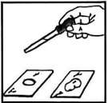
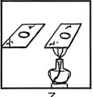
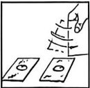

26. 实验桌上有两块完全相同的玻璃板，用滴管向玻璃板上分别滴加质量和初温均相同的水，小实同学通过如图17所示的三个实验过程，探究影响玻璃板上水蒸发快慢的因素。其中甲图所示实验探究的问题是：水蒸发的快慢与水的 ___ 是否有关。图 ___ 是探究水蒸发的快慢与水表面空气流速是否有关。该实验都用到的实验方法是 ___ （选填“转换法”或“科学推理法”或“控制变量法”）。

甲

乙

丙

图17

> [!question]- 点击查看答案与解析
> 【答案】表面积；丙；控制变量法
> 
> 【考点】影响蒸发快慢的因素、控制变量法 → [[【初中物理知识点体系-北师大版】#1-3 汽化和液化]]
> 
> 【解析】
> - 甲图：两滴水质量、初温相同，一滴聚拢、一滴摊开，改变了液体的表面积，探究的是蒸发快慢与表面积是否有关；
> - 乙图：一滴用水浴（酒精灯）加热、一滴不加热，探究的是蒸发快慢与温度是否有关；
> - 丙图：用扇子对其中一滴扇风，改变了液面上方的空气流速，探究的是蒸发快慢与空气流速是否有关，故选丙；
> - 三个实验都只改变一个因素而保持其他因素不变，用到的实验方法是控制变量法。
> 
> 【易错点】把“扇风”与“温度”对应错；混淆控制变量法与转换法。
