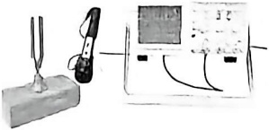
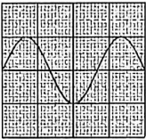
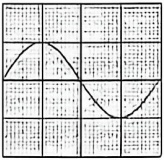
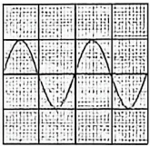
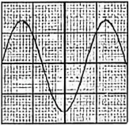
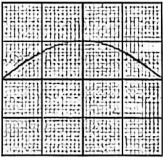

27. 敲击甲音叉，将其声音输入示波器，其波形如图18甲所示。如果用更大的力敲击甲音叉，其波形图可能是 ___ ；如果用相同的力度敲击另一个音叉乙，发现其音调比甲音叉更高，其波形图可能是 ___ 。

甲

A

B

C

D

图18

> [!question]- 点击查看答案与解析
> 【答案】C；B
> 
> 【考点】音调与频率、响度与振幅在波形图上的表现 → [[【初中物理知识点体系-北师大版】#3-2 声音的特性]]
> 
> 【解析】
> - 用力更大：只改变振幅（响度变大），波的疏密（频率）不变。C 图与甲图波数相同而波峰更高，故第一空填 C；
> - 音叉乙音调更高：只改变频率（波形更密），振幅不变。B 图在相同时间内波形更密（波数更多）而振幅与甲相近，故第二空填 B；
> - A 图与甲图基本相同，D 图波形更稀疏（频率更低），均不符合要求。
> 
> 【易错点】把“响度大”与“波形密”对应错；判断时只看波峰高低而不比较相同时间内的波数。
