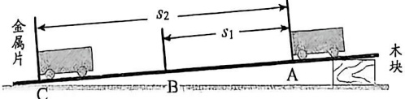

30. 小实同学利用如图20所示的实验装置做“测量小车的平均速度”的实验。他让小车从斜面的 $A$ 点由静止开始下滑，分别记录小车通过上半段路程 $s_{1}$ 和全程 $s_{2}$ 及所用时间 $t_{1}$、$t_{2}$。

（1）实验的原理是 ___ ；需要的测量工具有停表和 ___ 。

（2）小实同学调节木块的位置时，为了便于测量小车运动时间，应保持斜面的坡度较 ___ （填“大”或“小”）。

（3）小实同学测得 $t_{1}=2\text{s}$，$t_{2}=3\text{s}$，小车通过上半段路程和全程的平均速度分别 $v_{1}$ 和 $v_{2}$。请你判断 $v_{1}$ ___ $v_{2}$。（选填“大于”、“小于”或“等于”）

（4）由以上的测量，可以根据公式 $v_{3}=$ ___ 计算出下半程的平均速度 $v_{3}$。

（5）在测量小车由 $A$ 到 $B$ 的运动时，如果小实同学在小车还没到 $B$ 点就停止了计时，这样测得的平均速度 $v_{1}$ 会偏 ___ （选填“大”或“小”），理由是： ___ 。

> [!question]- 点击查看答案与解析
> 【答案】（1）$v=\frac{s}{t}$；刻度尺；（2）小；（3）小于；（4）$\frac{s_{2}-s_{1}}{t_{2}-t_{1}}$；（5）大；停止计时过早使测得的时间 $t_{1}$ 偏小，由 $v=\frac{s}{t}$ 可知算出的平均速度偏大
> 
> 【考点】平均速度的测量与计算 → [[【初中物理知识点体系-北师大版】#2-4 平均速度的测量]]
> 
> 【解析】
> （1）测平均速度的原理是 $v=\frac{s}{t}$，需要测路程和时间，工具为刻度尺和停表。
> （2）斜面坡度越小，小车下滑越慢，运动时间越长，便于测量时间、减小时间测量的误差。
> （3）上半程路程 $s_{1}=\frac{s_{2}}{2}$，则 $v_{1}=\frac{s_{2}/2}{t_{1}}=\frac{s_{2}}{4}$；全程 $v_{2}=\frac{s_{2}}{t_{2}}=\frac{s_{2}}{3}$。因为 $\frac{s_{2}}{4}<\frac{s_{2}}{3}$，所以 $v_{1}<v_{2}$，即上半程平均速度小于全程平均速度。
> （4）下半程的路程为 $s_{2}-s_{1}$，所用时间为 $t_{2}-t_{1}$，故 $v_{3}=\frac{s_{2}-s_{1}}{t_{2}-t_{1}}$。
> （5）提前停止计时，$t_{1}$ 的记录值小于真实值，而路程 $s_{1}$ 不变，由 $v=\frac{s}{t}$ 可知 $v_{1}$ 偏大。
> 
> 【易错点】（3）中直接用“时间短速度快”而忽略路程不同；（4）中忘记减去上半程的路程和时间。
