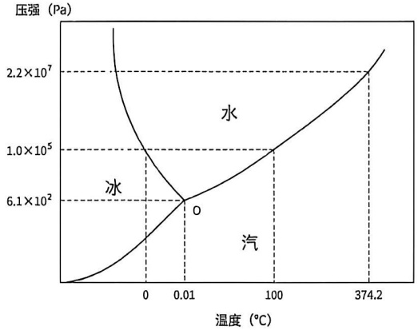

31. 请阅读《水的三相图》回答问题。

冬天河面结冰，烧水时水不断汽化，寒冷的窗玻璃上出现冰花，这些现象都与物态变化有关。我们常见的物质一般有三种状态：固态、液态、气态。物质的状态不是固定不变的，会随着温度、气压的改变发生相互转化。物理学中，用三相图可以直观表示一种物质在不同温度、不同气压下对应的状态，以及状态之间的分界关系。三相图的横坐标轴表示温度，纵坐标轴表示纯物质自身蒸气的压强（简写为：蒸气压）。

整张图被三条曲线分成三个区域：$①$ 低温、高压区域：固态；$②$ 中温、中压区域：液态；$③$ 高温、低压区域：气态。

三条分界线的含义：

（1）固液分界线（熔化/凝固线），线上任意一点：固、液共存；

（2）液气分界线（汽化/液化线），线上任意一点：液、气共存；

（3）固气分界线（升华/凝华线），线上任意一点：固、气共存。

三条曲线交汇的唯一公共点，叫做三相点。在水的三相点对应的温度和蒸气压下：冰、水、水蒸气三种状态可以同时共存、平衡存在。水的三相点是固定定值：温度 $0.01^{\circ}\text{C}$、蒸气压 $0.006$ 标准大气压。

（1）图中 $o$ 点叫作 ___ ，在该点对应的条件下，固态、液态和气态可以同时平衡共存。

（2）温度为 $50^{\circ}\text{C}$、压强为 $2\times10^{6}\text{ Pa}$ 下水的物态为 ___ （选填“固态”、“液态”、“气态”）

（3）在图示范围内，当压强低于三相点对应的压强时，冰缓慢吸热并越过固气分界线，将直接变成 ___ ，发生的物态变化是 ___ 。

> [!question]- 点击查看答案与解析
> 【答案】（1）三相点；（2）液态；（3）水蒸气（气态）；升华
> 
> 【考点】物态变化与三相图、压强对物态的影响 → [[【初中物理知识点体系-北师大版】#1-4 升华和凝华]]、[[【初中物理知识点体系-北师大版】#1-2 熔化和凝固]]
> 
> 【解析】
> （1）三条分界线的唯一公共点 $o$ 即三相点，此处固、液、气三态可同时平衡共存。
> （2）$2\times10^{6}\text{ Pa}$ 约为 $20$ 个标准大气压，属于“高压”，而 $50^{\circ}\text{C}$ 高于三相点温度 $0.01^{\circ}\text{C}$，对照三相图该点位于“中温、高压”的液态区域，故水处于液态。
> （3）压强低于三相点压强时，固气分界线之下冰不能先熔化成水，而是直接由固态变为气态的水蒸气，这一过程叫升华。
> 
> 【易错点】第（2）问只看温度不看压强，误判为气态；第（3）问把“升华”写成“熔化”或“汽化”。
