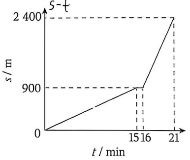

33. 小实同学周末去社区参加社会实践活动，她从家前往社区，整个过程中有步行，也有骑行，其全程的路程-时间图像如图所示。已知小实骑车的速度比步行的速度大，则：

（1）步行过程对应的图像是哪一段时间？

（2）骑车的速度是多少？

（3）整个过程的平均速度是多少？（结果保留一位小数）

> [!question]- 点击查看答案与解析
> 【答案】（1）$0\sim15\text{min}$；（2）$5\text{ m/s}$；（3）约 $1.9\text{ m/s}$
> 
> 【考点】路程-时间图像的分析、速度与平均速度的计算 → [[【初中物理知识点体系-北师大版】#2-3 运动的快慢]]
> 
> 【解析】
> 由图像可知：$0\sim15\text{ min}$ 内通过 $900\text{ m}$；$15\sim16\text{ min}$ 路程不变（停留）；$16\sim21\text{ min}$ 内路程由 $900\text{ m}$ 增至 $2400\text{ m}$。
> （1）$0\sim15\text{ min}$ 段图像的倾斜程度较小，速度较小，对应步行过程。
> （2）骑车过程为 $16\sim21\text{ min}$，时间 $t=5\text{ min}=300\text{ s}$，路程 $s=2400\text{ m}-900\text{ m}=1500\text{ m}$，
> $v_{骑}=\frac{1500\text{ m}}{300\text{ s}}=5\text{ m/s}$。
> （3）全程路程 $s_{总}=2400\text{ m}$，总时间 $t_{总}=21\text{ min}=1260\text{ s}$，
> $v_{平均}=\frac{2400\text{ m}}{1260\text{ s}}\approx1.9\text{ m/s}$。
> 答：步行对应 $0\sim15\text{ min}$；骑车速度为 $5\text{ m/s}$；全程平均速度约为 $1.9\text{ m/s}$。
> 
> 【易错点】把 $16\sim21\text{ min}$ 的时间误算为 $5\text{ min}$ 以外（如把 $21\text{ min}$ 直接代入）；求全程平均速度时漏算中间停留的 $1\text{ min}$。
