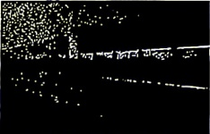

4. 某高架桥路段车辆通行频繁，噪声影响周边居民，为此在桥两侧安装了隔离墙，如图所示，其主要目的是 ( )

A. 减小噪声传播速度

B. 在声源处减弱噪声

C. 在传播过程中减弱噪声

D. 在接收处减弱噪声

> [!question]- 点击查看答案与解析
> 【答案】C
> 
> 【考点】减弱噪声的途径 → [[【初中物理知识点体系-北师大版】#3-4 噪声的危害和控制]]
> 
> 【解析】
> 减弱噪声有三条途径：在声源处、在传播过程中、在人耳（接收）处。桥两侧的隔离墙位于噪声源与居民之间，阻碍噪声向居民区传播，属于在传播过程中减弱噪声。故 C 正确。
> 
> 【易错点】隔离墙不是"减小传播速度"，而是在传播路径上阻挡、吸收和反射声波；声源处减弱对应加消声器，接收处减弱对应戴耳罩。
