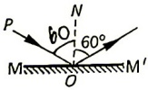
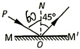
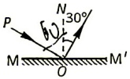
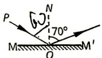

7. 如图所示的四个光路图中，MM′为平面镜，PO 为入射光线，ON 为法线，入射角∠PON 等于 60°，其中符合光的反射定律的光路图是 ( )

A

B

C

D

> [!question]- 点击查看答案与解析
> 【答案】A
> 
> 【考点】光的反射定律 → [[【初中物理知识点体系-北师大版】#4-2 光的反射]]
> 
> 【解析】
> 光的反射定律：反射光线、入射光线和法线在同一平面内；反射光线和入射光线分居法线两侧；反射角等于入射角。题中入射角∠PON 为 60°，故反射角也应为 60°。图 A 反射角为 45°，图 B 反射角为 30°，图 C 反射角为 70°，均不符合；只有 D 图反射角等于 60°，符合反射定律。
> 
> 【易错点】入射角是入射光线与法线的夹角，不是与镜面的夹角；与镜面夹角 30° 时入射角才是 60°。
