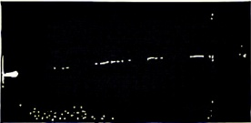

8. 学习“光的直线传播条件”时，老师做了如下演示实验：$①$ 用激光笔发射激光射向水中，观察到光线是一条直线；$②$ 沿容器内壁用漏斗向水的底部慢慢注入浓盐水，再用激光笔发射激光射向水中，观察到光线发生了弯曲（如图所示）；$③$ 水经搅拌后，观察到水中的光线又变直。根据上述现象可得出的结论是 ( )

A. 光总是沿直线传播

B. 光只有在水中才能沿直线传播

C. 光在浓盐水中不能沿直线传播

D. 光在同种均匀介质中才沿直线传播

> [!question]- 点击查看答案与解析
> 【答案】D
> 
> 【考点】光沿直线传播的条件 → [[【初中物理知识点体系-北师大版】#4-1 光的直线传播]]
> 
> 【解析】
> ①中水是均匀介质，光沿直线传播；②中注入浓盐水后，盐水与上层水未混合，介质不均匀，光发生弯曲；③搅拌后盐水与水混合均匀，光又沿直线传播。对比可知，光沿直线传播的条件是同种均匀介质，D 正确。
> 
> 【易错点】"光沿直线传播"有条件限制，不能说"光总是沿直线传播"；介质不均匀时光线会弯曲。
