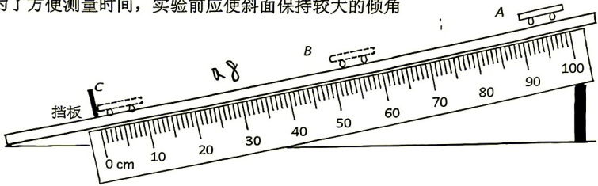

10. 如图所示是“测量平均速度”的实验情景。实验时，让小车从斜面上刻线处 A 点由静止开始运动到 B 点、C 点所用时间分别为 1.6s、2.4s。下列说法正确的是 ( )

A. 小车下滑过程是匀速直线运动

B. 小车 BC 段运动的平均速度为 $0.625\text{ m/s}$

C. 测量 BC 段平均速度，可将小车由 B 点静止释放

D. 为了方便测量时间，实验前应使斜面保持较大的倾角

> [!question]- 点击查看答案与解析
> 【答案】B
> 
> 【考点】平均速度的测量与计算 → [[【初中物理知识点体系-北师大版】#2-4 平均速度的测量]]
> 
> 【解析】
> 由图可知 A、B、C 对应刻度约为 100 cm、60 cm、10 cm，故 BC 段路程 $s_{BC}=60\text{ cm}-10\text{ cm}=50\text{ cm}=0.5\text{ m}$，所用时间 $t_{BC}=2.4\text{ s}-1.6\text{ s}=0.8\text{ s}$，则 $v_{BC}=\dfrac{s_{BC}}{t_{BC}}=\dfrac{0.5\text{ m}}{0.8\text{ s}}=0.625\text{ m/s}$，B 正确。
> A 项小车下滑速度越来越快，做加速直线运动，错误；C 项测 BC 段平均速度必须让小车从 A 点由静止释放，从 B 点释放会使经过 B 点的初速度为零，与原运动过程不符，错误；D 项斜面倾角越大，小车运动越快，时间越短越难测量，应使倾角较小，错误。
> 
> 【易错点】BC 段时间要用总时间相减，不能直接用 2.4 s；测某段平均速度必须保证该段运动状态与全程一致。
