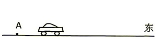
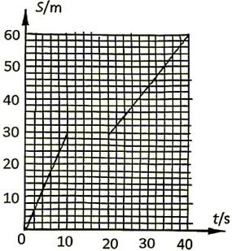

11. 一辆汽车在教练场上沿平直道路行驶。该车从 A 点向东出发到达某点后停止行驶，过一段时间后又向西返回出发位置 A，其行驶路程 s 与所用时间 t 的关系如图所示。下列分析不正确的是 ( )

A. 汽车最远位置距离出发点为 60m

B. 汽车在 10s-20s 时间没有行驶

C. 汽车在 20s-40s 时间向西行驶

D. 汽车在全程的平均速度为 1.5m/s

> [!question]- 点击查看答案与解析
> 【答案】A
> 
> 【考点】s-t 图像分析与平均速度计算 → [[【初中物理知识点体系-北师大版】#2-3 运动的快慢]]
> 
> 【解析】
> 由图像可知：0～10 s 路程由 0 增大到 30 m，汽车向东行驶；10～20 s 路程保持 30 m 不变，汽车静止；20～40 s 路程由 30 m 增大到 60 m，汽车向西返回 A 点。汽车最远位置距出发点为 30 m，A 项"60 m"错误。B、C 正确；全程平均速度 $v=\dfrac{s}{t}=\dfrac{60\text{ m}}{40\text{ s}}=1.5\text{ m/s}$，D 正确。故不正确的是 A。
> 
> 【易错点】s-t 图像中路程不变表示静止；返回过程路程仍在增加（路程是累积量），不能用"路程减小"理解；"最远位置"看最大位移而不是总路程。
