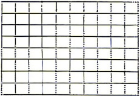
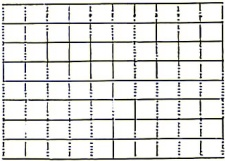
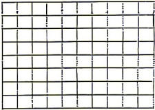

14. 如图所示，分别是音叉、钢琴、长笛发出的 C 调 l（do）的波形图。三种乐音相同的特性有 ( )

甲：音叉

乙：钢琴

丙：长笛

A. 振幅

B. 音调

C. 音色

D. 频率

> [!question]- 点击查看答案与解析
> 【答案】ABD
> 
> 【考点】乐音三要素与波形图 → [[【初中物理知识点体系-北师大版】#3-2 声音的特性]]
> 
> 【解析】
> 音叉、钢琴、长笛发出同一音调（C 调 do）的声音，三者的音调相同、频率相同；由图可见三种波形的振幅相同，即响度相同；但波形形状不同，说明音色不同。因此相同的特性是振幅、音调、频率，答案为 ABD。
> 
> 【易错点】音色由发声体的材料和结构决定，不同乐器音色一定不同；同一音调对应相同频率，波形疏密相同。
