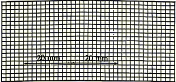

15. 心电图仪是医院常用的检查设备，它可将人体心跳产生的生物电流转化为随时间变化的波形图，并记录在匀速运动的坐标纸上。医生通过测量相邻波谷的时间间隔（即两次心跳的时间间隔），便可计算出患者的心率（次/min）。如图所示，是某被检者的心电图片段，相邻波谷间的纸面距离为 20mm，已知心电图走纸速度为 25mm/s。下列说法正确的是 ( )

A. 被检查者每次心跳的时间间隔为 0.8 s

B. 被检查者心率为 75 次/min

C. 1min 时间内，心电图坐标纸移动的长度为 1.5 m。

D. 若心电图走纸速度变大，测得被检查者的心跳时间间隔变大

> [!question]- 点击查看答案与解析
> 【答案】ABC
> 
> 【考点】速度公式在生活情境中的应用 → [[【初中物理知识点体系-北师大版】#2-3 运动的快慢]]
> 
> 【解析】
> 相邻波谷间纸面距离 $s=20\text{ mm}$，走纸速度 $v=25\text{ mm/s}$，则心跳时间间隔
> $t=\dfrac{s}{v}=\dfrac{20\text{ mm}}{25\text{ mm/s}}=0.8\text{ s}$，A 正确；
> 心率 $n=\dfrac{60\text{ s}}{0.8\text{ s}}=75$ 次/min，B 正确；
> 1 min 内纸移动长度 $s'=vt'=25\text{ mm/s}\times 60\text{ s}=1500\text{ mm}=1.5\text{ m}$，C 正确；
> 若走纸速度变大，纸面距离 20 mm 不变，测得时间间隔 $t=\dfrac{s}{v}$ 变小，D 错误。
> 
> 【易错点】"心跳时间间隔变大"错误，走纸越快，同样的心跳间隔在纸上拉得越长，但由纸面距离换算的时间反而变小。
