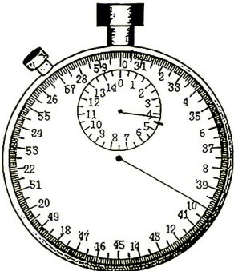

16. 在迎接学业水平体育技能测试的一次训练中，班主任老师用停表测量一位同学跑完 1000m 所用的时间是 ___ s，这个过程中该同学的平均速度为 ___ m/s。

> [!question]- 点击查看答案与解析
> 【答案】220；4.5
> 
> 【考点】停表的读数与平均速度的计算 → [[【初中物理知识点体系-北师大版】#2-1 长度和时间的测量]]、[[【初中物理知识点体系-北师大版】#2-3 运动的快慢]]
> 
> 【解析】
> 停表小表盘读数为 3 min（指针在 3 与 4 之间且未过半），大表盘读数为 40 s，故时间 $t=3\text{ min}40\text{ s}=220\text{ s}$。
> 平均速度 $v=\dfrac{s}{t}=\dfrac{1000\text{ m}}{220\text{ s}}\approx4.5\text{ m/s}$。
> 
> 【易错点】停表读数先读小表盘再读大表盘，小表盘指针过半则大表盘读第二圈（31～60 s）；平均速度保留一位小数即可。
