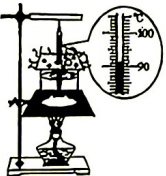
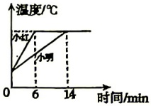

17. 如图所示，是探究水沸腾的实验装置。

甲

乙

（1）图甲中所示的某时刻温度计的示数是 ___ ℃

（2）加热过程中，水沸腾时观察到的现象是 ___ 。

（3）小红和小明选用相同的实验装置进行实验，根据两人的实验数据描绘出了温度随时间变化的图像。从图像看 ___ （选填“小红”“小明”）把水从初温加热到沸腾的过程中温度变化得比较快，可能原因是 ___ 。

> [!question]- 点击查看答案与解析
> 【答案】（1）96 （2）水中产生大量气泡，气泡在上升过程中逐渐变大，到水面破裂，放出水蒸气 （3）小红；小红实验所用水的质量较小（水量较少）
> 
> 【考点】温度计读数、水沸腾现象与沸腾图像 → [[【初中物理知识点体系-北师大版】#1-1 温度及其测量]]、[[【初中物理知识点体系-北师大版】#1-3 汽化和液化]]
> 
> 【解析】
> （1）温度计分度值为 1 ℃，液柱上表面在 90 ℃ 上方第 6 小格处，示数为 96 ℃。
> （2）水沸腾时，内部和表面同时汽化，水中产生大量气泡，气泡上升过程中不断变大，到水面破裂，释放出水蒸气；继续加热，温度保持不变。
> （3）由图像可知，两人初温相同、沸点相同，小红用 6 min 到达沸腾，小明用 14 min，小红升温更快。相同装置下，加热快慢主要取决于被加热水的质量，故原因是小红实验所用水的质量较小（水量较少）。
> 
> 【易错点】温度计读数要看清分度值和液柱位置，不能读成 94 ℃ 或 98 ℃；比较升温快慢时，初温相同才能直接比较所用时间。
