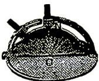

22. 如图所示的“探究光的反射规律”的实验装置，ON 是法线，用激光笔向入射点 O 发出一束光 AO，入射角 i，经平面镜反射后沿 OB 方向射出，反射角 r。请把下列实验步骤补充完整。

（1）保证 ___ 不变，调整入射光 AO 的方向，并将相应的反射角 r 与入射角 i 数值记录在下表中。

| i / 度 | 30 | 35 | 40 | 45 | 50 | 55 |
| --- | --- | --- | --- | --- | --- | --- |
| r / 度 | 30 | 35 | 40 | 45 | 50 | 55 |

分析表格中的数据，归纳得出： ___ 。

（2）利用图示的装置，多次改变入射光 AO 和法线 ON 所在的平面，从侧面观察反射光 OB、法线 ON 和入射光 AO，不断调整视线的角度，可以观察到 ___ 说明在光的反射现象中，反射光线、入射光线和法线在同一平面内。

> [!question]- 点击查看答案与解析
> 【答案】（1）入射点 O 的位置；反射角等于入射角 （2）反射光线、入射光线和法线都在同一平面内（三线共面）
> 
> 【考点】光的反射定律的探究 → [[【初中物理知识点体系-北师大版】#4-2 光的反射]]
> 
> 【解析】
> （1）探究反射角与入射角的关系时，必须控制入射点 O 的位置不变，只改变入射光的方向，这样才能保证反射面（平面镜）和法线位置不变。表中每一组数据都满足 r = i，故归纳得出：在光的反射现象中，反射角等于入射角。
> （2）多次改变入射光线与法线所在平面，从不同角度观察，只有在某一角度才能同时看到反射光线、入射光线和法线，说明这三条线在同一平面内。
> 
> 【易错点】结论要写成"反射角等于入射角"，不能说"入射角等于反射角"（反射角由入射角决定）；控制变量是"入射点位置"而不是"入射角"。
