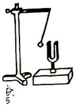

23. 用如图所示的器材（包括铁架台、音叉、橡胶锤和带细线的乒乓球等）探究声音的响度与发声物体振动的幅度是否有关。

（1）实验的自变量是 ___ ，改变自变量的方法是 ___

（2）实验的因变量是 ___ ，观察因变量的方法是 ___

（3）带细线的乒乓球的作用是 ___ 。

> [!question]- 点击查看答案与解析
> 【答案】（1）音叉振动的幅度（振幅）；用不同大小的力度敲击音叉 （2）声音的响度；听声音的大小（同时观察乒乓球被弹开的幅度） （3）将音叉微小的振动放大，便于观察
> 
> 【考点】响度与振幅的关系、转换法 → [[【初中物理知识点体系-北师大版】#3-2 声音的特性]]
> 
> 【解析】
> （1）本实验探究响度与振幅的关系，人为改变的量为音叉振动的幅度，故自变量是振幅；用橡胶锤以不同力度敲击音叉即可改变振幅。
> （2）随振幅变化而变化的量为响度，故因变量是响度；通过听声音的强弱（或观察乒乓球被弹开的幅度）来判断响度大小。
> （3）音叉的振动幅度很小，不易直接观察，用悬挂的乒乓球接触音叉，把微小振动放大为明显的摆动，这种方法是转换法。
> 
> 【易错点】自变量是"振幅"不是"敲击力度"（力度是改变振幅的手段）；乒乓球的作用是"放大振动"，不是"证明发声"。
