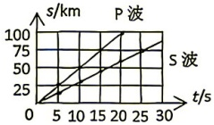

26. 地震波既有纵波（P波）也有横波（S波），是由同一震源同时产生的，它们在地壳中的传播速度不同。如图所示，是地震波从震源开始传播的距离 s 与所用时间 t 的关系图像。测得这两种波先后到达某监测站的时间间隔为 10s。求：

（1）纵波（P波）和横波（S波）在地壳中的传播速度。

（2）震源到监测站的距离。

> [!question]- 点击查看答案与解析
> 【答案】（1）$v_P=5\text{ km/s}$，$v_S=2.5\text{ km/s}$ （2）50 km
> 
> 【考点】s-t 图像求速度与追及问题 → [[【初中物理知识点体系-北师大版】#2-3 运动的快慢]]
> 
> 【解析】
> （1）由图像可知，P 波在 20 s 内传播 100 km，则
> $v_P=\dfrac{s_P}{t_P}=\dfrac{100\text{ km}}{20\text{ s}}=5\text{ km/s}$；
> S 波在 30 s 内传播 75 km，则
> $v_S=\dfrac{s_S}{t_S}=\dfrac{75\text{ km}}{30\text{ s}}=2.5\text{ km/s}$。
> （2）设震源到监测站的距离为 $L$，两波传播同一距离所用时间之差为 10 s：
> $\dfrac{L}{v_S}-\dfrac{L}{v_P}=10\text{ s}$，
> 即 $\dfrac{L}{2.5}-\dfrac{L}{5}=10$，解得 $L=50\text{ km}$。
> 
> 【易错点】时间间隔是"同一段距离"上两波用时之差，不是路程差；计算时单位要统一为 km 与 km/s。
