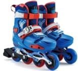
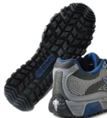
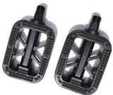
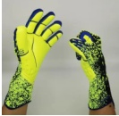

3. 如图所示的实例，目的是为了减小摩擦的是（）

A. 轮滑鞋装有滚轮

B. 运动鞋底有凹凸的花纹

C. 脚蹬面做得凹凸不平

D. 守门员戴着防滑手套

> [!question]- 点击查看答案与解析
> 【答案】A
> 
> 【考点】减小摩擦的方法 → [[【初中物理知识点体系-北师大版】#7-6 摩擦力]]
> 
> 【解析】
> - 减小摩擦的方法：减小压力、减小接触面粗糙程度、变滑动为滚动、使接触面分离；
> - 选项A：轮滑鞋装有滚轮，变滑动为滚动，减小摩擦，符合；
> - 选项B：运动鞋底有凹凸花纹，增大接触面粗糙程度，增大摩擦，不符合；
> - 选项C：脚蹬面凹凸不平，增大接触面粗糙程度，增大摩擦，不符合；
> - 选项D：守门员戴防滑手套，增大接触面粗糙程度，增大摩擦，不符合。
> 
> 【易错点】混淆增大摩擦和减小摩擦的方法，注意"变滑动为滚动"是减小摩擦的常用方法。
