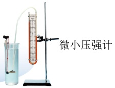
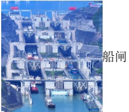
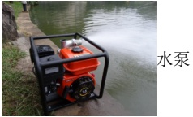

4. 如图所示的四个实例中，主要利用连通器原理工作的（）

A. 微小压强计

B. 水翼船

C. 船闸

D. 水泵

> [!question]- 点击查看答案与解析
> 【答案】C
> 
> 【考点】连通器原理 → [[【初中物理知识点体系-北师大版】#8-2 液体的压强]]
> 
> 【解析】
> - 连通器：上端开口、下端连通的容器，装同种液体静止时液面相平；
> - 选项A：微小压强计利用的是液体压强传递原理，不是连通器；
> - 选项B：水翼船利用流体压强与流速的关系（伯努利原理），不是连通器；
> - 选项C：船闸是典型的连通器应用，闸室与上下游依次构成连通器；
> - 选项D：水泵利用大气压工作，不是连通器。
> 
> 【易错点】混淆连通器与其他原理的应用，连通器必须满足"上端开口、下端连通"的条件。
