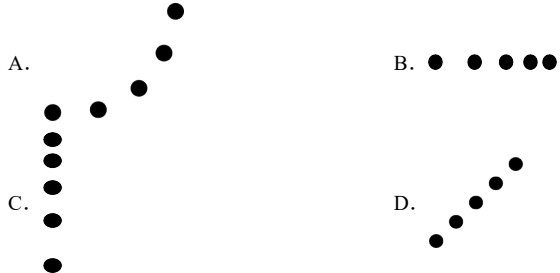

6. 频闪摄影是研究物体运动时常用一种实验方法，如图 ABCD 中分别用照相机拍摄（每 0.1s 拍摄一次）的小球在不同的运动状态下的照片，其中受到平衡力的作用的是

> [!question]- 点击查看答案与解析
> 【答案】D
> 
> 【考点】匀速直线运动 → [[【初中物理知识点体系-北师大版】#2-3 运动的快慢]]
> 
> 【解析】运动的物体在受平衡力时，保持匀速直线运动状态，匀速直线运动指经过的路线是直线，速度不变的运动，
>
> - 选项 A：轨迹是曲线，速度逐渐变大;
> - 选项 B：轨迹是直线，速度逐渐变大；
> - 选项 C：轨迹是直线，速度逐渐减小；
> - 选项 D：轨迹是直线，速度不变。
> 
> 【易错点】误认为频闪照片中相邻间距越大速度越快就是匀速直线运动；匀速直线运动必须同时满足"轨迹是直线"和"速度大小不变"两个条件，频闪照片中相邻位置间距相等才表示速度不变。
