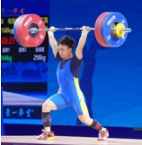

7. 如图所示，举重比赛要求运动员将水平地面上的杠铃竖直举过头顶后，在空中至少静止3秒钟，在这静止的3秒钟内，下列关于平衡力的说法中正确的是（）

A. 运动员所受重力和地面对运动员的支持力是平衡力

B. 杠铃对运动员压力和运动员对杠铃的支持力是平衡力

C. 杠铃对运动员压力和地面对运动员支持力是平衡力

D. 杠铃受到的重力和运动员对杠铃的支持力是平衡力

> [!question]- 点击查看答案与解析
> 【答案】D
> 
> 【考点】二力平衡条件 → [[【初中物理知识点体系-北师大版】#7-5 二力平衡]]
> 
> 【解析】
> - 二力平衡条件：作用在同一物体上、大小相等、方向相反、作用在同一直线上；
> - 选项A：运动员所受重力和地面对运动员的支持力，支持力等于运动员重力加杠铃重力，不是平衡力；
> - 选项B：杠铃对运动员压力和运动员对杠铃的支持力，作用在两个不同物体上，是相互作用力，不是平衡力；
> - 选项C：杠铃对运动员压力和地面对运动员支持力，方向相同，不是平衡力；
> - 选项D：杠铃受到的重力和运动员对杠铃的支持力，满足二力平衡条件，是平衡力。
> 
> 【易错点】混淆平衡力和相互作用力，平衡力作用在同一物体上，相互作用力作用在两个不同物体上。
