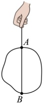
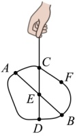

10. 为确定厚度均匀、形状不规则的平板状物体的重心位置，某同学将该物体上的 A 点悬挂在细线上，用铅笔在物体上画出细线的延长线 AB，如图甲所示。再将该物体上的 C 点悬挂在细线上，用铅笔在物体上画出细线的延长线 CD，CD 和 AB 的交点为 E，如图乙所示。

下列说法正确的是（）

甲 

乙 

A. 当图甲中的物体静止时，细线对物体拉力的方向和物体所受重力的方向不在一条直线上

B. 图乙中 E 点是物体的重心

C. 重心只跟物体的形状有关

D. 若将图乙中该物体上的 F 点悬挂在细线上，细线延长线不通过 E 点

> [!question]- 点击查看答案与解析
> 【答案】B
> 
> 【考点】重心的确定方法 → [[【初中物理知识点体系-北师大版】#7-3 重力]]
> 
> 【解析】
> - 用悬挂法确定重心：物体静止时，重力与拉力平衡，重心在细线延长线上；
> - 选项A：物体静止时，细线拉力和重力平衡，方向在同一直线上，错误；
> - 选项B：两次悬挂细线延长线的交点 E 就是重心，正确；
> - 选项C：重心不仅与形状有关，还与质量分布有关，错误；
> - 选项D：重心是唯一的，无论从哪里悬挂，细线延长线都通过重心 E，错误。
> 
> 【易错点】误认为重心只与形状有关，实际上重心还与质量分布有关。
