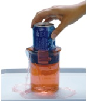

11. 如图所示，把装满水的烧杯放在盘子的中央，再把空的饮料罐逐渐按入水中，在手感受到浮力增大的同时，会看到排开的水不断地溢至盘中。关于此现象，下列说法中 $\underset{\cdot}{不}$ 正确的是（）

A. 说明饮料罐受到的浮力大小与它排开水的体积有关

B. 手对饮料罐的作用力始终等于饮料罐对手的作用力

C. 饮料罐受到的浮力大小始终等于饮料罐受到的重力

D. 饮料罐受到的浮力大小始终等于烧杯中溢出的水的重力

> [!question]- 点击查看答案与解析
> 【答案】C
> 
> 【考点】阿基米德原理 → [[【初中物理知识点体系-北师大版】#8-5 浮力]]
> 
> 【解析】
> - 阿基米德原理：浸在液体中的物体受到的浮力等于它排开液体的重力；
> - 选项A：手感受到浮力增大，说明浮力与排开水的体积有关，正确；
> - 选项B：手对饮料罐的作用力和饮料罐对手的作用力是相互作用力，始终相等，正确；
> - 选项C：饮料罐被按入水中过程中，浮力逐渐增大，不等于重力；当浮力大于重力时，松手后饮料罐会上浮，错误；
> - 选项D：根据阿基米德原理，浮力等于排开水的重力，正确。
> 
> 【易错点】误认为浮力始终等于重力，实际上只有漂浮或悬浮时浮力才等于重力。
