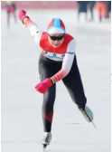
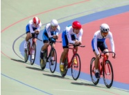
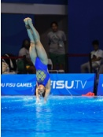
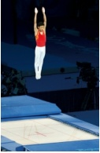

12. 关于如图所示的四种体育比赛中的情景，下列分析正确的是（）

A. 滑冰运动员单脚滑行时对冰面的压强小于她双脚站立时对冰面的压强

B. 运动员骑着自行车绕着环形场地骑行时，人相对于赛道是静止的

C. 跳水运动员从空中入水的过程中，运动员在水中不受浮力

D. 蹦床运动员在空中上升的过程中，运动员所受的合力方向竖直向下

> [!question]- 点击查看答案与解析
> 【答案】D
> 
> 【考点】压强、运动与静止的相对性、浮力、力的合成 → [[【初中物理知识点体系-北师大版】#8-1 压强]]、[[【初中物理知识点体系-北师大版】#2-2 运动的描述]]、[[【初中物理知识点体系-北师大版】#8-5 浮力]]、[[【初中物理知识点体系-北师大版】#7-4 牛顿第一定律]]
> 
> 【解析】
> - 选项 A：滑冰运动员单脚滑行时受力面积减小，根据 $p=\dfrac{F}{S}$，压强增大，不是减小，错误；
> - 选项 B：运动员骑着自行车绕着环形场地骑行时，人相对于赛道位置不断变化，是运动的，错误；
> - 选项 C：跳水运动员从空中入水的过程中，运动员排开水的体积不为零，根据阿基米德原理，仍然受到浮力，错误；
> - 选项 D：蹦床运动员在空中上升的过程中，只受重力（忽略空气阻力），合力方向竖直向下，正确。
> 
> 【易错点】误认为单脚滑行压强减小（实际受力面积减小，压强增大）；误认为上升过程中合力方向向上（实际只受重力，合力向下）。
