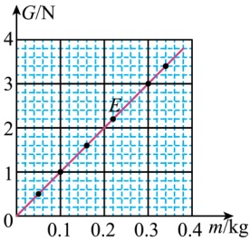

13. 小萱用天平测出 6 个不同物体的质量 m，再用弹簧测力计测出它们所受的重力 G。她根据所测数据绘制的图像如图所示。根据图像提供的信息，下列判断正确的是（）

A. 该图像表明物体的质量跟其所受重力成正比

B. 该图像表明物体所受的重力跟其质量成正比

C. 该图像表明物体所受的重力跟其质量的比值为 10

D. 根据数据点 E 可知：质量为 0.21kg 的物体受到的重力为 2.1N

> [!question]- 点击查看答案与解析
> 【答案】B
> 
> 【考点】重力与质量的关系 → [[【初中物理知识点体系-北师大版】#7-3 重力]]
> 
> 【解析】
> - 图像是 G-m 图像，横轴是质量 m，纵轴是重力 G；
> - 选项A：图像表明重力与质量成正比，不是质量与重力成正比，错误；
> - 选项B：图像是过原点的直线，表明重力与质量成正比，正确；
> - 选项C：比值为重力与质量之比，即 g，约为 10 N/kg，不是 10，错误；
> - 选项D：从图像看，质量为 0.21 kg 时，重力约为 2.1 N，但这是估算值，不够准确，错误。
> 
> 【易错点】混淆"重力与质量成正比"和"质量与重力成正比"的表述，前者正确，后者错误。
