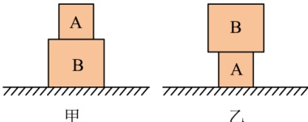

15. （2分）两个均匀物体 $A$、$B$，质量分别为 $m_{A}$、$m_{B}$，密度分别为 $\rho_{A}$、$\rho_{B}$，底面积分别为 $S_{A}$、$S_{B}$，高度分别为 $h_{A}$、$h_{B}$。将 $A$、$B$ 叠放在水平桌面上，如图甲、乙所示。图甲中，$A$ 对 $B$ 的压强为 $p_{1}$，$B$ 对桌面的压强为 $p_{2}$；图乙中，$B$ 对 $A$ 的压强为 $p_{3}$，$A$ 对桌面的压强为 $p_{4}$，则下列关系正确的是（）

A. $p_{1}=\rho_{A}gh_{A}=\frac{m_{A}g}{S_{B}}$

B. $p_{2}=\frac{(m_{A}+m_{B})g}{S_{B}}$

C. $p_{3}=\rho_{B}gh_{B}=\frac{m_{B}g}{S_{B}}$

D. $p_{4}=\frac{(m_{A}+m_{B})g}{S_{B}}$

> [!question]- 点击查看答案与解析
> 【答案】B
> 
> 【考点】固体压强公式 $p=\frac{F}{S}$（受力面积取接触面积）、均匀柱体对水平面压强 $p=\rho gh$ 的适用条件 → [[【初中物理知识点体系-北师大版】#8-1 压强]]
> 
> 【解析】
> 由原卷图可知 $A$ 较小、$B$ 较大，即 $S_{A}<S_{B}$。压强公式的分母是**接触面积（受力面积）**，不一定是施力物体自身的底面积。
> 
> 甲图（$A$ 叠在 $B$ 上）：
> - $A$ 对 $B$：压力 $F_{1}=m_{A}g$，接触面为 $A$ 的底面 $S_{A}$，故 $p_{1}=\frac{m_{A}g}{S_{A}}=\rho_{A}gh_{A}$（均匀柱 $A$ 单独平放时 $\rho_A gh_A=\frac{m_A g}{S_A}$）。选项 A 把分母写成 $S_{B}$，错误。
> - $B$ 对桌面：压力 $F_{2}=(m_{A}+m_{B})g$，接触面为 $B$ 的底面 $S_{B}$，故 $p_{2}=\frac{(m_{A}+m_{B})g}{S_{B}}$。**选项 B 正确**。
> 
> 乙图（$B$ 叠在 $A$ 上）：
> - $B$ 对 $A$：压力 $F_{3}=m_{B}g$，接触面为较小的 $S_{A}$，故 $p_{3}=\frac{m_{B}g}{S_{A}}$。而 $\rho_{B}gh_{B}=\frac{m_{B}g}{S_{B}}\neq p_{3}$——$p=\rho gh$ 只适用于均匀柱体以**整个底面**承压的情况，此处 $B$ 的底面并未全部接触 $A$。选项 C 错误。
> - $A$ 对桌面：压力 $F_{4}=(m_{A}+m_{B})g$，接触面为 $A$ 的底面 $S_{A}$，故 $p_{4}=\frac{(m_{A}+m_{B})g}{S_{A}}$。选项 D 把分母写成 $S_{B}$，错误。
> 
> 验证（数值自校验 13 项全部通过）：取两组满足 $S_{A}<S_{B}$ 的均匀柱数据（组1：$m_A=2,S_A=1,h_A=1,m_B=6,S_B=2,h_B=1.5$；组2：$m_A=3,S_A=1.5,h_A=0.8,m_B=5,S_B=4,h_B=1.2$，单位略），逐项计算真实压强 $p_1=\frac{m_A g}{S_A}$、$p_2=\frac{(m_A+m_B)g}{S_B}$、$p_3=\frac{m_B g}{S_A}$、$p_4=\frac{(m_A+m_B)g}{S_A}$，均验证：均匀柱恒等式 $\rho g h=\frac{mg}{S}$ 成立；选项 A、C、D 的表达式与真实值不相等（分母错用 $S_B$），选项 B 与真实值精确相等；两组数据结论一致，唯一正确选项为 B，与菁优网收录的同卷官方答案一致。**题干补全说明**：本地原卷与源试卷文件中第15题题干均因 OCR 丢失（原标注"题干缺失，待补充原文"），已按线上同卷（北师大附中系 2023—2024 学年八下期中，第15题）恢复完整题干；恢复后题干与本地四个选项逐字吻合（A、C、D 中分母 $S_B$ 均为原卷错误选项设计，非 OCR 笔误），配图（甲：A 压 B；乙：B 压 A）与题干描述一致。本题为概念辨析选择题，原卷配图已足够，无需另绘解题图。
> 
> 【易错点】一是见柱体就用 $p=\rho gh$：乙图中 $B$ 对 $A$ 的压强不能用 $\rho_{B}gh_{B}$，因为 $B$ 与 $A$ 的接触面积 $S_{A}$ 小于 $B$ 的底面积 $S_{B}$，只有"均匀柱体水平放置且整个底面承压"时两式才等价；二是压强分母误取"下方物体"或"自己"的底面积，正确规则是取**两物体的接触面积**（叠放时等于较小者）；三是对桌面压强，甲中接触面是 $S_{B}$、乙中是 $S_{A}$，两问分母不同，别把 $p_2$ 与 $p_4$ 混为一谈。
> 
> Sources:
> - [菁优网·试题详情（两个均匀物体A、B叠放）](https://www.jyeoo.com/shiti/2910fd8f-815e-415d-95d7-d48f98987259)
> - [学科网·北京师范大学附属实验中学2023-2024学年八年级下学期物理期中考试卷](https://m.zxxk.com/soft/45103399.html)
