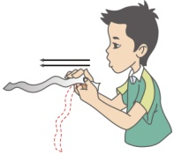
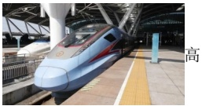

16. 图甲所示，沿纸条上方吹气时，纸条向上飘。如图所示的实例中，其原理与图甲所示现象原理相同的是（）

甲 

A. 提供飞机飞行的升力

B. 铁安全线设计

C. 人在海面上漂浮

D. 热气球飘在空中

> [!question]- 点击查看答案与解析
> 【答案】AB
> 
> 【考点】流体压强与流速的关系 → [[【初中物理知识点体系-北师大版】#8-4 流体压强与流速的关系]]
> 
> 【解析】
> - 沿纸条上方吹气，纸条上方空气流速大、压强小，下方压强大，产生向上的压强差，纸条向上飘；
> - 选项 A：飞机机翼上凸下平，上方空气流速大压强小，产生向上的升力，原理相同，符合；
> - 选项 B：高铁安全线设计，是因为乘客靠近高铁的一侧空气流速快、压强小；另一侧空气流速慢、压强大，若果距离高铁太近，容易被推向高铁造成事故，利用了伯努利原理，故B符合题意；
> - 选项 C：人在海面上漂浮是利用浮力原理，与流体压强无关；
> - 选项 D：热气球飘在空中是利用浮力原理（热空气密度小于冷空气），与流体压强无关。
> 
> 【易错点】混淆流体压强与浮力的应用场景，需明确流体压强与流速的关系只适用于气体和液体的流动。
