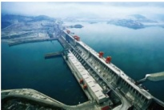
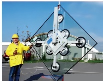

17. 如图所示的事例中，属于利用大气压的是（）

A. 用注射器吸取药液

B. 拦河坝形状上窄下宽

C. 人能漂浮在死海上

D. 工人用吸盘搬运玻璃

> [!question]- 点击查看答案与解析
> 【答案】AD
> 
> 【考点】大气压强的应用 → [[【初中物理知识点体系-北师大版】#8-3 大气压强]]
> 
> 【解析】
> - 选项 A：用注射器吸取药液时，拉动活塞，注射器内气压减小，外界大气压将药液压入注射器，利用了大气压，符合；
> - 选项 B：拦河坝形状上窄下宽是因为液体压强随深度增加而增大，与大气压无关，不符合；
> - 选项 C：人能漂浮在死海上是因为死海水的密度大，人受到的浮力等于重力，与大气压无关，不符合；
> - 选项 D：工人用吸盘搬运玻璃时，吸盘内空气被排出，外界大气压将吸盘紧压在玻璃上，利用了大气压，符合。
> 
> 【易错点】混淆大气压应用与液体压强、浮力现象，需明确大气压应用的特征是"通过减小内部气压，利用外界大气压工作"。
