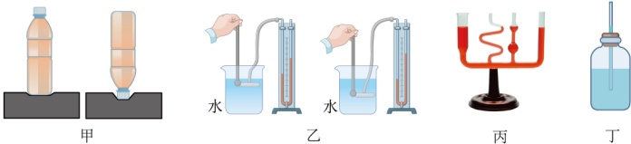

19. 关于如图所示的四个实验，下列描述正确的是（）

A. 图甲：一瓶橙汁先后放在相同的海绵上，海绵凹陷程度不同，说明压力大小不同

B. 图乙：在水中，压强计的金属盒所处的深度增加，它受到的水的压强也随之增加

C. 图丙：连通器中装入同种液体，液体静止时，连通器各部分中的液面总保持相平

D. 图丁：将自制气压计随电梯从一楼上升至十楼，气压计细玻璃管中的液面会上升

> [!question]- 点击查看答案与解析
> 【答案】BCD
> 
> 【考点】压强、液体压强、连通器、大气压强 → [[【初中物理知识点体系-北师大版】#8-1 压强]]
> 
> 【解析】
> - 选项 A：图甲中一瓶橙汁先后放在相同的海绵上，海绵凹陷程度不同，说明受力面积不同导致压强不同，而不是压力大小不同，错误；
> - 选项 B：图乙中压强计的金属盒在水中深度增加，U 形管两侧液面高度差增大，说明液体压强随深度增加而增大，正确；
> - 选项 C：图丙中连通器中装入同种液体，液体静止时，各部分液面总保持相平，这是连通器的原理，正确；
> - 选项 D：图丁中将自制气压计从一楼上升至十楼，外界大气压减小，瓶内气压大于外界气压，细玻璃管中的液面会上升，正确。
> 
> 【易错点】误认为图甲实验说明压力不同（实际是受力面积不同导致压强不同），或误认为气压计液面会下降。
