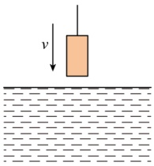
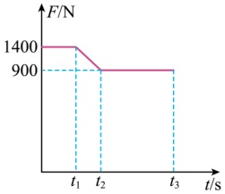

20. 如图所示的甲图中，石料在钢绳拉力的作用下从水面上方以恒定的速度下降，直至全部没入水中。图乙是钢绳拉力 $F$ 随时间 $t$ 变化的图像。若不计水的阻力，下列说法中正确的是（）

甲 

乙 

A. 石料所受的重力为 $1400N$

B. 石料所受的浮力为 $900N$

C. 石料的体积为 $2.3 \times 10^{-3} \, m^{3}$

D. 石料的密度为 $2.8 \times 10^{3} \, kg/m^{3}$

> [!question]- 点击查看答案与解析
> 【答案】BD
> 
> 【考点】浮力、阿基米德原理、密度 → [[【初中物理知识点体系-北师大版】#8-5 浮力]]
> 
> 【解析】
> - 从图乙可知：石料在空中时钢绳拉力 $F_1 = 1400 \, \text{N}$，此时 $F_1 = G$，故石料重力 $G = 1400 \, \text{N}$；
> - 石料完全浸入水中后钢绳拉力 $F_2 = 500 \, \text{N}$，此时 $F_2 = G - F_{\text{浮}}$，故浮力 $F_{\text{浮}} = G - F_2 = 1400 - 500 = 900 \, \text{N}$，选项 B 正确；
> - 由阿基米德原理 $F_{\text{浮}} = \rho_{\text{水}} g V_{\text{排}}$，石料完全浸没时 $V = V_{\text{排}} = \dfrac{F_{\text{浮}}}{\rho_{\text{水}} g} = \dfrac{900}{1.0 \times 10^3 \times 10} = 9 \times 10^{-2} \, \text{m}^3$，选项 C 错误；
> - 石料质量 $m = \dfrac{G}{g} = \dfrac{1400}{10} = 140 \, \text{kg}$，密度 $\rho = \dfrac{m}{V} = \dfrac{140}{9 \times 10^{-2}} \approx 1.56 \times 10^3 \, \text{kg/m}^3$，选项 D 错误。
> 
> 【易错点】误认为石料在水中时拉力等于重力，实际拉力等于重力减去浮力；计算密度时需注意单位换算。
