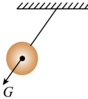
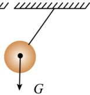
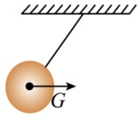
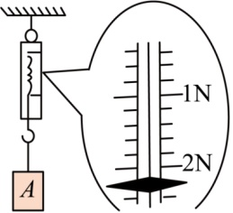

28. （1）在图中，图 ___ 所示是小球在空中摆动时受重力的示意图；

甲 

乙 

丙 

（2）如图所示，弹簧测力计的示数为 ___ N。

> [!question]- 点击查看答案与解析
> 【答案】（1）乙；（2）2.2
> 
> 【考点】重力方向、弹簧测力计读数 → [[【初中物理知识点体系-北师大版】#7-1 力]]
> 
> 【解析】
> - （1）重力的方向始终竖直向下，与物体运动状态无关。甲图中力的方向沿绳子方向，丙图中力的方向斜向，只有乙图中力的方向竖直向下，故选乙；小球的重心在小球的球心，不管物体怎样运动，其所受重力的方向总是竖直向下的，所以小球在空中摆动时受到重力的方向也是竖直向
>
> - （2）弹簧测力计读数时，先看清量程和分度值，再读取指针所指刻度。由图知道，1N被分成了5份，即分度值为0.2N；图中示数为 2.2 N。
> 
> 【易错点】误认为重力方向沿绳子方向（实际重力方向始终竖直向下）；读数时未注意分度值导致读错。
