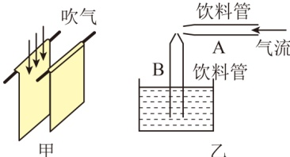
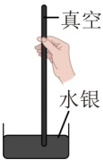
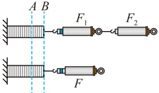

29. 如图所示的四个实验或生活现象，请你回答下列问题：

（1）如图甲所示，向两张纸片中间吹气，可观察到两纸片向中间靠拢，此实验现象说明：气体在流速大的地方压强 ___ （选填“大”或“小”）。根据这一规律制作了如图乙所示的装置，当他向饮料管 A 中吹气时，饮料管 B 中的液面会 ___ （选填“上升”、“不变”或“下降”）；

（2）如图所示，将水银气压计从山下带到山上，管内水银面将 ___ （选填“上升”、“不变”或“下降”）；

（3）研究“同一直线上二力合成”，如图所示，实验中两个力 $F_{1}$ 和 $F_{2}$ 同时拉弹簧与一个力 $F$ 单独拉弹簧，都要将弹簧右端点从位置 A 拉伸到位置 B。这样做目的是为了保证力 ___ （选填“改变物体的形状”或“改变物体的运动状态”）的效果相同。

> [!question]- 点击查看答案与解析
> 【答案】（1）小；上升；（2）下降；（3）改变物体的形状
>
> 【考点】流体压强与流速的关系、大气压强、力的合成 → [[【初中物理知识点体系-北师大版】#8-4 流体压强与流速的关系]]、[[【初中物理知识点体系-北师大版】#8-3 大气压强]]、[[【初中物理知识点体系-北师大版】#7-1 力]]
>
> 【解析】
> - （1）向两张纸片中间吹气，中间空气流速大，压强小，纸片外侧压强大，所以纸片向中间靠拢；根据流体压强与流速的关系，向饮料管A吹气时，B管上方空气流速大压强小，管内液体在大气压作用下会上升；
> - （2）大气压随海拔升高而减小，将水银气压计从山下带到山上，外界大气压减小，管内水银面会下降；
> - （3）实验中两个力同时拉弹簧与一个力单独拉弹簧，都要将弹簧右端点从位置A拉伸到位置B，这样做目的是为了保证力改变物体的形状的效果相同（等效替代法）。
>
> 【易错点】（1）误认为流速大压强大，实际流体流速大的地方压强小；（2）误认为海拔升高大气压增大，实际大气压随海拔升高而减小；（3）不理解等效替代法的思想。
