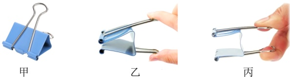

30. 长尾夹是一种常见的办公用品，如图甲所示，小明在使用时发现，让夹子张开 3mm 时所用的力较小，如图乙所示，让夹子张开 10mm 时需要用很大的力，如图丙所示。请你就此现象提出一个可探究的科学问题 ___ 。

> [!question]- 点击查看答案与解析
> 【答案】弹簧的伸长量与受到的拉力是否有关？
> 
> 【考点】科学探究、弹力 → [[【初中物理知识点体系-北师大版】#7-1 力]]
> 
> 【解析】
> - 长尾夹张开时需要用力，夹子张开越大（形变越大），需要的力越大；
> - 可探究的科学问题：弹簧的伸长量与受到的拉力是否有关？
> - 这是一个可探究的问题，因为可以通过实验测量不同拉力下弹簧的伸长量来验证。
> 
> 【易错点】提出的问题不可探究（如"为什么夹子会弹回"），应提出可以通过实验验证的问题。
