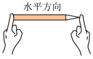
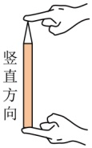

31. 探究压力的作用效果与受力面积的关系时，分别采用如图甲、乙所示的两种方法。用两只手的食指分别压在铅笔两端。

甲 

乙 

（1）手压铅笔的同时，手也感到疼痛，说明 ___ ；

（2）图 ___ 的方法不能探究压力的作用效果与受力面积的关系，理由是 ___ ；

（3）图甲中铅笔笔尖面积是 0.5mm²，笔尾的面积是 0.4cm²，两手指均用 2N 的力对压铅笔两端，则笔尖对手指的压强为 ___ Pa。

> [!question]- 点击查看答案与解析
> 【答案】（1）力的作用是相互的；（2）乙，没有控制压力相同；（3）$4 \times 10^4$
> 
> 【考点】压力的作用效果、压强计算 → [[【初中物理知识点体系-北师大版】#8-1 压强]]
> 
> 【解析】
> - （1）手压铅笔时，手对铅笔施加力，同时铅笔也对手施加力，手感到疼痛说明力的作用是相互的；
> - （2）图乙中两手指受到的压力不同（铅笔重力影响），没有控制压力相同，不能探究压力作用效果与受力面积的关系；
> - （3）笔尖面积 $S = 0.5 \, \text{mm}^2 = 0.5 \times 10^{-6} \, \text{m}^2$，压强 $p = \dfrac{F}{S} = \dfrac{2}{0.5 \times 10^{-6}} = 4 \times 10^4 \, \text{Pa}$。
> 
> 【易错点】单位换算错误（$\text{mm}^2$ 转 $\text{m}^2$ 需乘以 $10^{-6}$），或误认为图乙可以探究。
