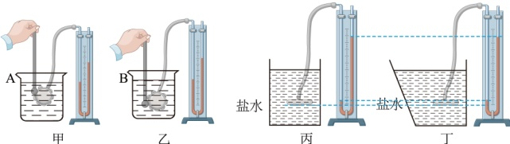

32. 水平实验桌面上有微小压强计和装有等体积的酒精和浓盐水的 A、B 两个烧杯，如图所示。

（1）用手轻轻按压了探头的橡皮膜，若 U 形管中液面高度差变化 ___ （选填 “明显” 或 “不明显”），说明装置的气密性良好。微小压强计是通过 ___ 来反映被测压强的大小；

（2）当微小压强计的探头放入液体中不同深度时，发现微小压强计 U 形管两侧的液面高度差相同，如图甲、乙所示，若已知浓盐水的密度大于酒精的密度，由此可以判断浓盐水是 ___ （选填“甲”或“乙”）；

（3）由丙、丁两图进行实验对比，得出液体压强与盛液体的容器形状 ___ （选填 "有关" 或 "无关"）。

> [!question]- 点击查看答案与解析
> 【答案】（1）明显；U 形管两侧液面高度差；（2）乙；（3）无关
>
> 【考点】液体压强实验、微小压强计 → [[【初中物理知识点体系-北师大版】#8-2 液体的压强]]
>
> 【解析】
> - （1）用手按压橡皮膜，若装置气密性良好，U 形管中液面高度差变化明显；微小压强计通过 U 形管两侧液面高度差来反映被测压强的大小；
> - （2）根据 $p=\rho gh$，深度相同时，液体密度越大，压强越大。浓盐水密度大于酒精，所以浓盐水中压强更大，U 形管液面高度差更大，故浓盐水是乙；
> - （3）丙、丁两图中，液体密度和深度相同，容器形状不同，但 U 形管液面高度差相同，说明液体压强与容器形状无关。
>
> 【易错点】误认为液体压强与容器形状有关；未理解控制变量法的应用。
