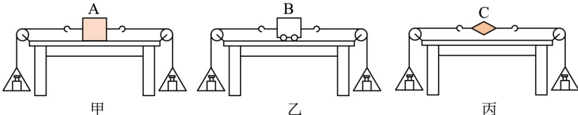

33. 小军和小红利用图甲所示装置探究二力平衡条件。实验时，他们发现在左盘和右盘同时加入一个质量相等的砝码时，木块 A 处于静止状态。若再将一个质量较小的砝码轻轻放在右盘后，观察到木块 A 仍然处于静止状态，为了避免这种现象发生，小军用图乙中所示的小车 B 替换木块 A 进行实验。

（1）小军用小车 B 替换木块 A 进行实验的目的是 ___ ；

（2）小红利用轻质硬纸片 C 替换木块 A 进行实验，为了验证相互平衡的两个力作用在同一直线上，她将左盘和右盘中分别放入一个质量相等的砝码，接下来的操作是： ___ 。

> [!question]- 点击查看答案与解析
> 【答案】（1）减小摩擦力对实验的影响；（2）将硬纸片旋转一个角度，松手后观察硬纸片是否保持平衡
>
> 【考点】二力平衡条件实验 → [[【初中物理知识点体系-北师大版】#7-5 二力平衡]]
>
> 【解析】
> - （1）木块与桌面间有较大的滑动摩擦力，会影响实验结果；用小车替换木块，变滑动为滚动，减小摩擦力对实验的影响；
> - （2）验证两个力是否作用在同一直线上，需要将硬纸片旋转一个角度（使两个力不在同一直线上），松手后观察硬纸片是否保持平衡。若硬纸片不能保持平衡（会转回原位置），说明相互平衡的两个力必须作用在同一直线上。
>
> 【易错点】未理解实验操作的目的；混淆"旋转角度"与"改变力的大小"。
