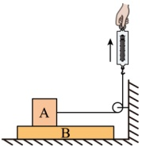
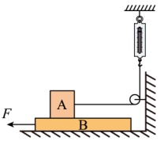
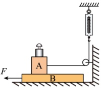

35. 在学习摩擦力时，小丽猜想滑动摩擦力的大小可能与物体运动的压力大小、速度大小、接触面的粗糙程度以及接触面的面积大小有关，为此，她分别进行了探究实验。在小丽通过如图所示的装置探究"物体所受滑动摩擦力的大小与接触面的面积大小是否有关"的实验过程中：

图1 

甲 

乙 

图2 

（1）实验中小丽用弹簧测力计缓慢拉动木块，使木块在长木板上做 ___ 运动，这样做是根据 ___ 的知识得出拉力等于摩擦力，从而测出木块所受的摩擦力的大小；

（2）小丽发现弹簧测力计的示数经常不稳定，用如图1进行某次实验时，物体做加速运动，则所测得的滑动摩擦力 ___ （选填"偏大"或"偏小"）。为了解决上述问题，小丽做了如图2所示的改进，利用该装置的优点是 ___ ；

（3）小丽利用图2甲、乙进行实验，她探究问题是：滑动摩擦力的大小与 ___ 是否有关；

（4）小丽接着做了两次实验：

$①$ 小丽拉动木板的速度为 $v_{1}$ 时，弹簧测力计的示数为 $F_{1}$;

$②$ 小丽拉动木板的速度为 $v_{2}$ 时，弹簧测力计的示数为 $F_{2}$;

其中， $v_{1}$ ___ $v_{2}$（选填"等于"或"不等于"），若发现 ___ 现象，就可以得出木块A所受的滑动摩擦力大小跟物体的运动速度无关。

> [!question]- 点击查看答案与解析
> 【答案】（1）匀速直线；二力平衡；（2）偏大；不需要木板做匀速直线运动，便于操作且弹簧测力计示数稳定；（3）接触面的面积大小；（4）不等于；$F_{1}=F_{2}$
>
> 【考点】滑动摩擦力影响因素、控制变量法 → [[【初中物理知识点体系-北师大版】#7-6 摩擦力]]
>
> 【解析】
> - （1）用弹簧测力计拉动木块做匀速直线运动，木块处于平衡状态，根据二力平衡知识，拉力等于摩擦力；
> - （2）物体做加速运动时，拉力大于摩擦力，测得的滑动摩擦力偏大；图2装置中，木板不需要做匀速直线运动，木块A始终处于静止状态（平衡状态），弹簧测力计示数稳定，便于读数；
> - （3）图2甲、乙中，木块平放和侧放，接触面积不同，控制压力和接触面粗糙程度相同，探究滑动摩擦力与接触面面积大小的关系；
> - （4）探究摩擦力与速度的关系时，应控制其他因素相同，改变速度，即 $v_{1}$ 不等于 $v_{2}$；若弹簧测力计示数 $F_{1}=F_{2}$，说明滑动摩擦力大小与速度无关。
>
> 【易错点】误认为摩擦力与速度有关；未理解图2装置的优点（不需要匀速拉动木板）。
