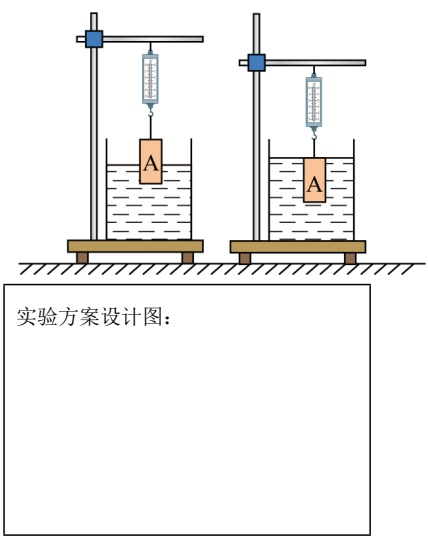

36. 在探究浮力大小与哪些因素有关的实验中，小利猜想浮力大小与液体的密度、物体排开液体的体积和物体在液体中的深度有关。

（1）在 “探究浮力大小与液体的密度是否有关” 的实验中，请帮助小利将以下主要实验步骤补充完整：

$①$ 用调好的弹簧测力计测出铁块A所受重力 $G$，并记录；

$②$ 把铁块 A 分别浸没在酒精和盐水中的同一深度处于静止状态，且铁块 A 与容器的底和壁均未接触，用弹簧测力计测出拉力 F，并记录；

$③$ 根据公式 $F_{浮} = \underline{\hspace{2cm}}$，计算铁块 A 在两种不同的液体中所受到的浮力大小，并记录；

（2）在“探究浮力大小与物体排开液体的体积是否有关”的实验中，小利设计了实验记录表格并填写了部分记录信息，如下表所示。表格的第一行的空格中应写明的物理量的名称及单位是 ___ ；

| 实验次数 | 液体种类 | 铁块A排开液体的体积 | 铁块A所受重力 G/N | 测力计示数 F/N |
|---|---|---|---|---|
| 1 | 酒精 | 小 | | |
| 2 | 酒精 | 大 | | |

（3）在“探究浮力大小与物体在液体中的深度是否有关”的实验中，小利分别测量了铁块A在盐水中不同深度时所受到的拉力大小，如图所示。同组的小强认为小利的设计不能实现探究目的。请你利用已有实验器材，在虚线框中画出能实现探究目的的实验方案图。

> [!question]- 点击查看答案与解析
> 【答案】（1）G-F；（2）铁块A所受重力 G/N；（3）应让铁块A分别浸没在盐水中的不同深度
>
> 【考点】浮力影响因素、控制变量法 → [[【初中物理知识点体系-北师大版】#8-5 浮力]]
>
> 【解析】
> - （1）根据称重法，浮力 F_浮=G-F；
> - （2）表格中需要记录铁块A所受重力 G/N，用于计算浮力；
> - （3）探究浮力与深度的关系时，应控制液体密度和排开液体体积相同（即浸没），改变深度，比较浮力是否变化。
>
> 【易错点】未理解控制变量法的应用；探究深度影响时未控制排开液体体积相同。
