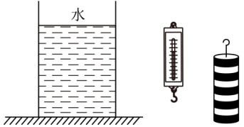

37. 小明同学一直想要自己验证：水产生的压强与深度有关，但是家里没有微小压强计。在学完浮力测量方法后，了解到浮力可以用弹簧测力计来测量。当老师讲完浮力产生的原因后知道，浮力产生是由于液体对物体上下表面有压力差。他继续思考，如果物体下表面浸在液体中，上表面在空气中，此时物体受到的浮力就是物体下表面所受液体的压力，这样用弹簧测力计测出的浮力即液体对物体下表面的压力。家里现有器材如下：弹簧测力计、装有适量的烧杯、底面积为 $S$（数值已知）且侧面有刻度值的圆柱体金属块（ $\rho_{\text{金属块}} > \rho_{\text{水}}$），如图所示。请利用上述器材设计实验证明：水产生的压强与深度有关。请你写出主要实验步骤，画出实验数据记录表。

> [!question]- 点击查看答案与解析
> 【答案】实验步骤：①用弹簧测力计测出圆柱体金属块的重力 G；②将金属块部分浸入水中，读出弹簧测力计示数 F₁，记录金属块下表面在水中的深度 h₁；③改变金属块浸入水中的深度，读出弹簧测力计示数 F₂，记录金属块下表面在水中的深度 h₂；④根据 F_浮=G-F 计算浮力，即液体对下表面的压力，再根据 p=F/S 计算压强；⑤比较不同深度处的压强。实验数据记录表：| 实验次数 | 深度 h/cm | 弹簧测力计示数 F/N | 浮力 F_浮/N | 压强 p/Pa |
> 
> 【考点】液体压强与深度的关系、浮力测量 → [[【初中物理知识点体系-北师大版】#8-2 液体的压强]]、[[【初中物理知识点体系-北师大版】#8-5 浮力]]
> 
> 【解析】
> - 利用称重法测浮力：F_浮=G-F，当金属块上表面在空气中时，浮力等于液体对下表面的压力；
> - 根据 p=F/S，可计算出液体对下表面的压强；
> - 改变金属块下表面在水中的深度，多次测量，比较不同深度处的压强，验证液体压强与深度的关系。
> 
> 【易错点】未控制金属块上表面在空气中（否则浮力不等于下表面受到的压力）；未进行多次实验得出结论。
