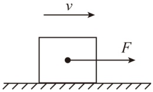

38. 一木箱在水平地面上向右运动，此时木箱在水平方向只受滑动摩擦力，滑动摩擦力 $f = 50 \, N$；此时若对木箱施加一个水平向右、大小不变的推力 $F$，如图所示，木箱仍向右运动，结合运动和力的关系分析，木箱受到推力 $F$ 后可能出现的运动情况。

> [!question]- 点击查看答案与解析
> 【答案】木箱可能做匀速直线运动，也可能做加速直线运动
> 
> 【考点】力与运动的关系、二力平衡 → [[【初中物理知识点体系-北师大版】#7-5 二力平衡]]
> 
> 【解析】
> - 木箱原来向右运动，受到向左的滑动摩擦力 $f = 50 \, \text{N}$；
> - 若施加水平向右的推力 $F = 50 \, \text{N}$，则推力等于摩擦力，木箱受平衡力，做匀速直线运动；
> - 若施加水平向右的推力 $F > 50 \, \text{N}$，则推力大于摩擦力，木箱受非平衡力，做加速直线运动；
> - 若施加水平向右的推力 $F < 50 \, \text{N}$，则推力小于摩擦力，木箱受非平衡力，做减速直线运动。
> 
> 【易错点】只考虑一种情况，未全面分析推力与摩擦力的各种大小关系；误认为有力作用就一定加速运动。
