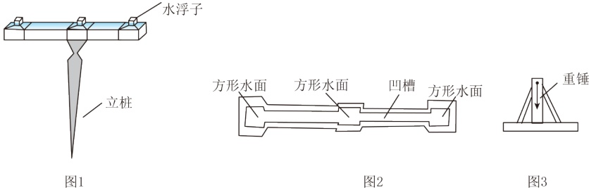
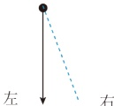

39. 请阅读《匠人建国，水地以县》并回答问题。

匠人建国，水地以县

匠人建国，水地以县（“县”通“悬”），指古代建设城邑的求水平、定方位的测量处理，是我国古代劳动人民智慧的结晶。宋朝的建筑学著作《营造法式》对此进行了传承和发展，对正式建筑的建造提出了严格完整的要求，包括筑基、立基、取正、定平等。

筑基，即建造地基。筑基时，先挖开场地，然后填土和碎石瓦块，最后夯实。这种处理方法与我们今天消除场地缺陷的做法相似。古建筑一般较轻，场地处理不需要太深。

立基，就是在处理好的地基平地上建造台基。立基时，根据房屋面积大小和地基不均匀性的影响，可适当增减台基高度和宽度。

取正，就是要求房屋面朝正南。取正时，一般利用圭表、日晷等，参照正午太阳的位置而定，先确定南北正轴线，再正交确定东西走向。

定平，就是保证台基面和柱础石顶面的水平。定平时，对于较大的台基面，要“据其位置，于四角各立一标，当心安水平”。即：根据选定的方位，在四个角各立一个标杆，在中心位置用立柱安放好水平仪。水平仪的上方有长条形凹槽，图1为其正面立体图，凹槽内部装有水，在水平仪的方形水面上，各自放上一枚漂浮的水浮子，图2为其俯视图（未放水浮子）。使用时，先转动水平仪使其对准某一标杆，人眼调整观察角度，使三枚水浮子刚好重叠，此时在人眼视线对应的标杆上画上刻线。以此类推，在四个角的标杆上都标定刻线，此时四条刻线即在同一个水平面上。

对于柱础石的定平，要用到水平尺。如图3所示，中间的立柱与底部的直尺垂直，立柱从上至下刻有一道与直尺垂直的墨线（图中虚线），用细线悬挂重锤，当细线与墨线对齐时，则表明底部直尺所在的面是水平的。

请根据上述材料，回答下列问题：

（1）在筑基的时候，如果建筑物较高较重，那么场地处理应该更 ___ （选填“深”或“浅”）一些。立基时增加台基的宽度，主要是为了 ___ ；

（2）若利用图3所示的水平尺检验柱础石顶面是否水平时，观察到细线与墨线（图中虚线）的位置关系如图4所示，则说明柱础石顶面 ___ （选填“左”或“右”）侧较高；

图4 

（3）分析说明使用水平尺时，为什么细线与墨线对齐时能表明底部直尺所在的面是水平的 ___ ？

> [!question]- 点击查看答案与解析
> 【答案】（1）深；减小压强；（2）左；（3）重力的方向始终竖直向下，当细线与墨线对齐时，说明立柱竖直，又因为立柱与直尺垂直，所以直尺所在的面是水平的
> 
> 【考点】重力方向、压强、垂直与水平的关系 → [[【初中物理知识点体系-北师大版】#7-3 重力]]、[[【初中物理知识点体系-北师大版】#8-1 压强]]
> 
> 【解析】
> - （1）建筑物较高较重时，需要更深地基来分散压力；增加台基宽度是增大受力面积，减小压强；
> - （2）图4中细线偏向墨线左侧，说明重锤向左偏，立柱向左倾斜，说明左侧较高；
> - （3）重力的方向始终竖直向下，当细线与墨线对齐时，说明立柱沿竖直方向；又因为立柱与底部直尺垂直，所以直尺所在的面与竖直方向垂直，即水平面。
> 
> 【易错点】混淆"竖直"与"垂直"的概念；不理解重锤线原理（利用重力方向竖直向下）。
