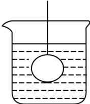

40. 如图所示，圆柱形容器中盛有适量的水，质量 $m$ 为 1.2kg，体积 $V$ 为 $1 \times 10^{-3} \, \text{m}^3$ 的金属球被细绳系住，细绳另一端用手提住，使金属球浸没在水中静止，已知 $\rho = 1 \times 10^3 \, \text{kg/m}^3$， $g$ 取 10N/kg。求：

（1）对图中金属球进行受力分析：

（2）图中金属球受到的浮力；

（3）图中细绳对金属球的拉力。

> [!question]- 点击查看答案与解析
> 【答案】（1）金属球受重力、浮力和拉力三个力；（2）10N；（3）2N
> 
> 【考点】浮力计算、受力分析 → [[【初中物理知识点体系-北师大版】#8-5 浮力]]
> 
> 【解析】
> - （1）金属球浸没在水中静止，受三个力：竖直向下的重力 $G$、竖直向上的浮力 $F_{\text{浮}}$ 和细绳的拉力 $F_{\text{拉}}$；
> - （2）根据阿基米德原理：$F_{\text{浮}} = \rho_{\text{水}} g V_{\text{排}} = 1 \times 10^3 \times 10 \times 1 \times 10^{-3} = 10 \, \text{N}$；
> - （3）金属球重力 $G = mg = 1.2 \times 10 = 12 \, \text{N}$；金属球静止，三力平衡：$F_{\text{拉}} + F_{\text{浮}} = G$，故 $F_{\text{拉}} = G - F_{\text{浮}} = 12 - 10 = 2 \, \text{N}$。
> 
> 【易错点】受力分析时遗漏某个力；计算浮力时未注意金属球完全浸没，$V_{\text{排}} = V_{\text{球}}$。
