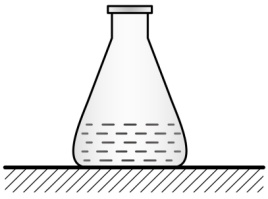

41. 如图所示，盛有水的锥形瓶静止在水平桌面上，空瓶重 0.5N，高 10.5cm，瓶内水重 1N，水深 4cm，若认为瓶内底面积与瓶外底面积相等均为 30cm²，水的密度取 1×10³kg/m³。

（1）水对锥形瓶底的压力；

（2）锥形瓶对桌面的压强。

> [!question]- 点击查看答案与解析
> 【答案】（1）1.2N；（2）500Pa
> 
> 【考点】液体压强计算、固体压强计算 → [[【初中物理知识点体系-北师大版】#8-2 液体的压强]]、[[【初中物理知识点体系-北师大版】#8-1 压强]]
> 
> 【解析】
> - （1）水对锥形瓶底的压强：$p = \rho_{\text{水}} g h = 1 \times 10^3 \times 10 \times 0.04 = 400 \, \text{Pa}$；
> - 水对锥形瓶底的压力：$F = pS = 400 \times 30 \times 10^{-4} = 1.2 \, \text{N}$；
> - （2）锥形瓶对桌面的压力等于总重力：$F' = G_{\text{瓶}} + G_{\text{水}} = 0.5 + 1 = 1.5 \, \text{N}$；
> - 锥形瓶对桌面的压强：$p' = \dfrac{F'}{S} = \dfrac{1.5}{30 \times 10^{-4}} = 500 \, \text{Pa}$。
> 
> 【易错点】混淆液体压强和固体压强的计算方法；计算压力时未进行单位换算（$\text{cm}^2$ 转 $\text{m}^2$ 需乘以 $10^{-4}$，$\text{cm}$ 转 $\text{m}$ 需乘以 $10^{-2}$）。
